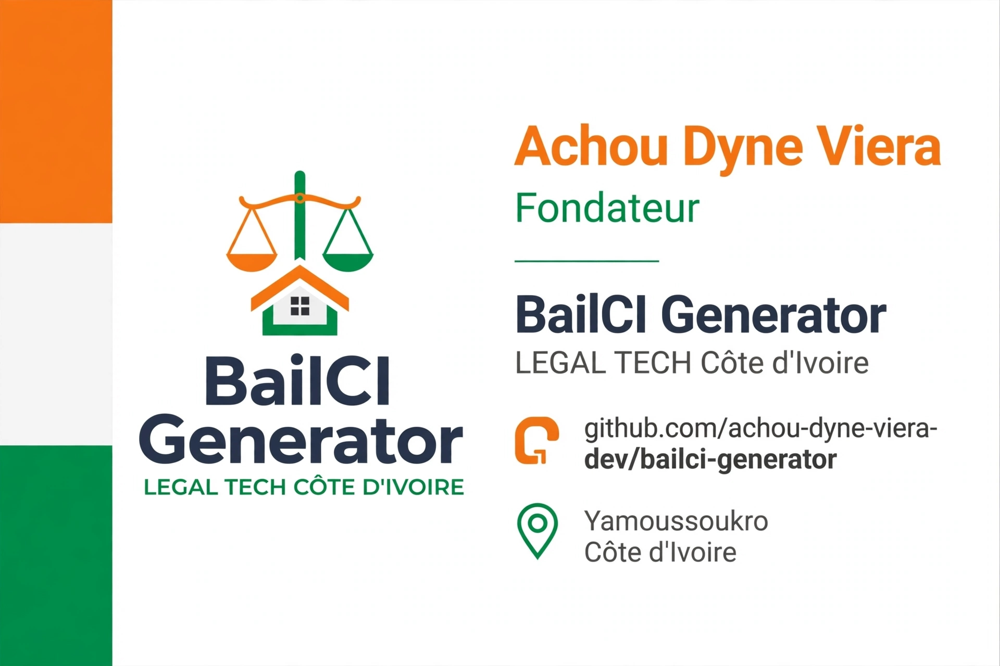
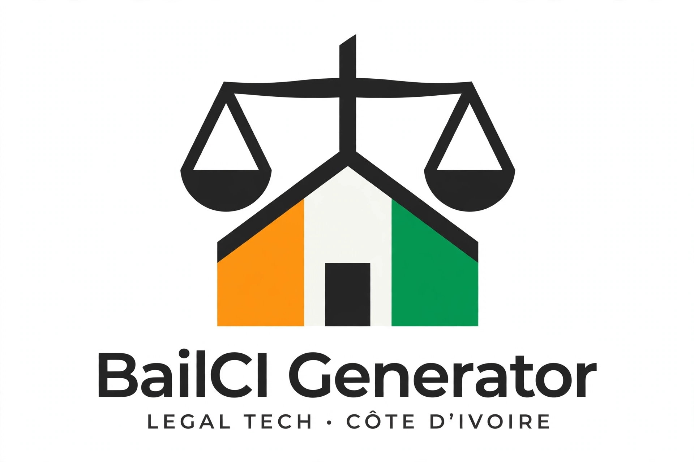

# 🇨🇮 BailCI Generator - Legal Tech Côte d'Ivoire
# BailCI Generator 🇨🇮

Générateur de baux d'habitation conformes au **décret n°2026-596 du 6 juillet 2026** (en vigueur 01/10/2026).

Projet développé dans le cadre du BTS IDA - Objectif INPHB.

### ⚖️ Pourquoi ce projet ?
Le nouveau contrat type impose une clause résolutoire intégrée d'office. 90% des modèles en ligne sont non-conformes. BailCI automatise la conformité.

### ✅ Conformité gérée
- [x] Clause résolutoire obligatoire à **6 semaines (42 jours)** après commandement pour loyer/charges/dépôt
- [x] Mentions obligatoires 2026
- [ ] Options facultatives : défaut d'assurance / troubles voisinage
- [ ] Validateur automatique : Date >= 01/10/2026 + mention "2 mois" = Alerte non-conformité

### 🛠️ Stack
Python / PDF Generation / Validation légale

### 🚀 Roadmap
- v0.1 : Modèle bail nu conforme
- v0.2 : Générateur meublé + colocation
- v0.3 : Export PDF + QR Code légal

### 👤 Auteur
Achou Dyne Viera - BTS IDA | Futur Ingénieur INPHB
Yamoussoukro, CI
